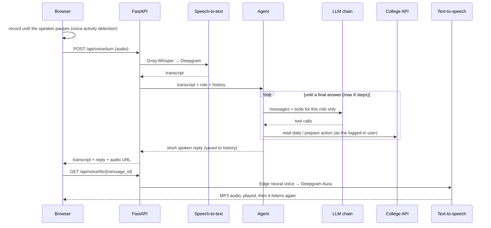

# KIT Voice Assistant

A real-time voice assistant for **Knotopian Institute of Technology (KIT)**, a dummy college.
Applicants, students and teachers talk to it and hear a short spoken reply within a couple of seconds. It answers from the college's own data and documents, and completes simple requests: admission applications, leave and on-duty requests, placement registration and teacher approvals.

**Live app:** _to be added_

---

## What it does

| Mode | Who | The assistant can |
|---|---|---|
| Public home page (no login) | People who want to join | Answer admission questions (courses, eligibility, fees, seats, dates, documents) and submit an admission application. It has no tool that can read student data. |
| Student (login) | Current students | Attendance per subject (and how many classes they can miss or must attend), timetable for any date, holidays and exams, college rules, leave and on-duty requests, request status and cancellation, placement drives with eligibility, placement registration, subject doubts from lesson notes. |
| Teacher (login) | Teachers | Their classes, class attendance, pending leave/on-duty requests, approve or reject them. |
| History | Everyone | Past conversations, scoped to the signed-in person (or to the browser for visitors). |

Every request that changes something is **read back and needs a spoken "yes"** before it is submitted.

## How a voice turn works



More detail: [`docs/ARCHITECTURE.md`](docs/ARCHITECTURE.md) · edge cases: [`docs/EDGE_CASES.md`](docs/EDGE_CASES.md) · college API: [`docs/COLLEGE_API.md`](docs/COLLEGE_API.md)

## Tech stack

| Part | Choice | Why |
|---|---|---|
| Backend | Python 3.11, FastAPI, httpx, SQLAlchemy (async), pydantic-settings | Async I/O for many external calls, typed config and schemas |
| LLM | Groq `openai/gpt-oss-120b` → Gemini `gemini-3.5-flash` → Groq `gpt-oss-20b` → Groq `qwen3.8-27b` → Gemini `3.1-flash-lite` | Fast tool calling (0.4–2 s); rate-limited models are skipped on cooldown |
| Speech-to-text | Groq `whisper-large-v3-turbo` → Deepgram `nova-3` | Accurate for Indian English, with a college vocabulary hint |
| Text-to-speech | Edge neural voice `en-IN-NeerjaNeural` → Deepgram `aura-2` → browser voice | Natural Indian English voice, free |
| Documents | Pulled from the college API at runtime → PDF text → rule-level chunks → BM25 | No embedding service to fail; picks up new or surprise documents without a restart |
| Frontend | React 18, Vite, TypeScript, plain CSS | Small, fast, accessible |
| Storage | Postgres (Supabase in production), SQLite for bare local runs | Durable history and sessions |

The browser's built-in speech recognition is **not** used; all speech-to-text runs on the server.

## Run it

You only need **Docker**. Keys: a free [Groq](https://console.groq.com) key is enough; [Gemini](https://aistudio.google.com) and [Deepgram](https://console.deepgram.com) keys switch on the fallbacks.

```bash
git clone https://github.com/kuzhandayan/kit_voice_assistant.git && cd kit_voice_assistant
cp .env.example .env        # fill in COLLEGE_PARTICIPANT_KEY and GROQ_API_KEY (+ optional GEMINI_API_KEY, DEEPGRAM_API_KEY)
docker compose up --build   # open http://localhost:5173
```

This starts the backend (FastAPI, reloads on save), the frontend (Vite, reloads on save) and Postgres. The microphone works on `localhost` and on https.

## Configuration

All settings come from environment variables (see [`.env.example`](.env.example)).

| Variable | Required | Notes |
|---|---|---|
| `COLLEGE_PARTICIPANT_KEY` | yes | Sent as `X-Participant-Key` on every college API call |
| `SESSION_SECRET` | yes | At least 16 characters |
| `GROQ_API_KEY` | yes | LLM and speech-to-text |
| `GEMINI_API_KEY`, `DEEPGRAM_API_KEY` | no | Fallback LLM, STT and TTS |
| `LLM_CHAIN` | no | `vendor:model[@reasoning_effort]`, comma separated, tried in order |
| `DATABASE_URL` | prod only | Docker Compose uses its own Postgres; in production use the Supabase **session pooler** URL |
| `APP_ENV` | no | `production` turns on secure cookies and turns off CORS |

## Deploy (Render, one app)

1. Push the repo to GitHub.
2. On Render: **New → Blueprint** → pick the repo. `render.yaml` defines one Docker web service with a health check.
3. Fill in the secret values: `COLLEGE_PARTICIPANT_KEY`, `GROQ_API_KEY`, `GEMINI_API_KEY`, `DEEPGRAM_API_KEY`, and `DATABASE_URL` (Supabase **session pooler** URL). `SESSION_SECRET` is generated.
4. Add a free uptime monitor on `https://<app>/api/health` every 5 minutes so the free instance doesn't sleep.

## Tests and checks

With the app running:

```bash
docker compose exec backend sh -c "ruff check app tests && pytest -q"   # 50 tests: rules, permissions, confirm flow, fallbacks, documents
docker compose exec frontend sh -c "npx tsc -b && npm test"              # types + voice activity detection
```

## Project structure

```
backend/app/
  main.py                 app factory, security headers, serves the built frontend
  container.py            builds and wires every service once at startup
  core/                   config, errors, principal (role + owner), rate limiting
  api/                    routes: auth, assistant (chat + voice + tts), history, health
  db/                     models + repositories (sessions, conversations, pending actions)
  services/
    resilience.py         one timeout + fallback helper shared by STT, LLM and TTS
    college/              typed client for the college API + college clock
    knowledge/            document loading, chunking, BM25 search
    llm/                  provider chain
    speech/               STT and TTS chains
    agent/
      orchestrator.py     tool-calling loop
      prompts.py          system prompt per role
      guards.py           handbook rules as pure, tested functions
      tools/              public, student, teacher, common tools + role-scoped registry
    conversation.py       one turn: history → agent → save (shared by text and voice)
frontend/src/
  api/client.ts           typed API calls
  lib/vad.ts              voice activity detection (pure, tested)
  hooks/                  useRecorder, useAudioPlayer, useVoiceAssistant, useAuth
  components/             VoiceAssistant, VoiceOrb, Transcript, Layout
  pages/                  Home, Login, Assistant, History
docs/                     architecture, edge cases, college API notes, todo
```

## Security and reliability

- **Role-scoped tools.** The tool list is chosen from the server session, never from the prompt. Visitors have no tool that reads student data, and students have no approval tools.
- **Acts only for the logged-in person.** "My" tools take no student id; the college token in the server-side session decides whose data is read.
- **Server-side sessions.** The browser holds only a random id in an httpOnly, SameSite cookie (Secure in production); the college token never reaches the browser and is stored against a SHA-256 of that id.
- **Confirm before write.** Write actions are prepared, checked against handbook rules, read back, and run only on "yes". Each pending action is consumed once and sent with an `Idempotency-Key`, so a repeated "yes" can't submit twice.
- **Rules enforced in code.** For example: no personal leave or on-duty on internal assessment days, no retrospective personal leave, no overlapping requests, on-duty needs an event name, placement eligibility. The assistant gives the rule number in its reply.
- **College date.** All date logic uses the college system's own date (`/v1/today`), which differs from the real date.
- **Failover.** Every external call has a timeout. STT, LLM and TTS each have fallback providers, and college API reads retry once. If everything fails, the user hears a short apology instead of an error page.
- **Limits.** Audio size and type checks, text length limits, per-session rate limits, and security headers.

## Known limitations

- Free-tier AI limits: Groq allows about 8K tokens/min per model. Under heavy load the app falls back to other models, which can be slightly slower.
- Edge TTS uses Microsoft's public neural voices without an SLA. If it fails, Deepgram Aura and then the browser voice take over.
- Rate limiting and caches are in memory, which suits a single instance. Several instances would need Redis.
- Render's free plan sleeps when idle; the first request after a long pause is slow unless the uptime ping is on.
- Interrupting while the assistant speaks is tap-to-interrupt, not automatic, to avoid the assistant hearing itself through the speakers.
