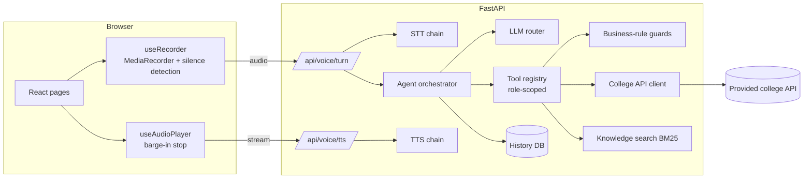

# Architecture

## Goals
1. Natural, fast voice conversation (target < 3 s from end of speech to first audio).
2. Correct answers grounded in college data and documents — never invented.
3. Strict data isolation: public sees nothing personal; users only act for themselves.
4. Keeps working when one AI service fails.
5. Easy to change when the college API or rules change mid-event.

## Components

## Key design decisions

| Decision | Why |
|---|---|
| Request/response voice turns (not WebSockets) | Simpler, robust on free hosting, easy to test. Latency kept low by fast providers and returning text before audio. |
| Text first, audio second (`/turn` then `/tts`) | User sees the transcript and reply instantly; TTS streams separately and can fall back independently. |
| One `with_fallback` helper (`services/resilience.py`) | STT, LLM and TTS share the same timeout/retry/fallback logic — one tested component, not three copies. |
| OpenAI-compatible adapter for Groq and Gemini | One code path for tool calling; the chain is config (`LLM_CHAIN=vendor:model@effort,...`). Chain: Groq gpt-oss-120b → Groq gpt-oss-20b → Groq qwen3.8-27b → Gemini 3.5 Flash → Gemini 3.1 Flash Lite. Each attempt has an 8 s limit; a provider that times out is skipped for 30 s (seen live: Gemini hanging 15 s under load). Each Groq model has its own free-tier limit (8K tokens/min), so more models = more headroom. |
| Tool registry keyed by role (`public`, `student`, `teacher`) | Security in code. The LLM only ever sees tools it is allowed to use. |
| User id injected server-side | Tool schemas for "self" data have no `student_id` argument at all. |
| Confirm-before-write | All write tools return a pending action; the agent reads it back and only `confirm_action` submits it. Prevents wrong submissions from mis-heard speech. |
| Guards before writes | Rules like "no leave on exam days", date validity, past dates, overlapping requests are checked in code using college API data + handbook config. |
| BM25 over PDFs, not embeddings | Small corpus, zero extra API, deterministic, no cold-start cost. Search tool is scoped by source (brochure / handbook / notes) and by role. |
| Explicit "today" in system prompt (Asia/Kolkata) | Correct handling of "tomorrow", "next Monday". |
| SQLite locally, Postgres in prod via `DATABASE_URL` | Zero setup for reviewers; durable history in deployment. |
| Single Docker image | One deploy target, one https URL, no CORS. |

## Request flow (voice turn)
1. Browser records until ~1.7 s of silence (or the user taps stop). Max 30 s, max 5 MB.
2. `POST /api/voice/turn` (multipart audio + `conversation_id`).
3. STT chain → transcript. Empty/too-short transcript → "Sorry, I didn't catch that."
4. Agent loop (max 6 tool rounds): LLM with role tools → execute tools → feed results back → final reply. Reply style: short, spoken, no markdown.
5. Save user + assistant messages (and tool calls) to history.
6. Respond `{conversation_id, transcript, reply, tts_id}`.
7. Browser requests `/api/voice/tts?tts_id=…` and plays the stream. If the user speaks, playback stops (barge-in).

## Tools (mapped to `docs/COLLEGE_API.md`)
| Role | Read | Write (needs spoken confirm) |
|---|---|---|
| public | `get_college_info`, `list_courses`, `search_documents` (brochure only) | `submit_admission_application` |
| student | `get_my_profile`, `get_my_academics`, `get_my_subjects`, `get_my_timetable` (per date, handles holidays and special working days), `get_calendar`, `get_my_attendance` (with classes needed / still missable), `get_attendance_sessions`, `list_my_requests`, `list_placement_drives` (with eligibility), `list_my_placements`, `search_documents` | `create_leave_or_od_request`, `cancel_my_request`, `register_for_placement` |
| teacher | `get_my_profile`, `list_my_classes`, `list_class_requests`, `get_class_attendance`, `get_calendar`, `search_documents` (handbook, circulars, notes) | `approve_request`, `reject_request` |
| all | — | `confirm_action`, `cancel_action` |

## College date
The college system runs on its own date (`/v1/today` ≠ real date). A `CollegeClock` service caches `/v1/today` (short TTL) and is the only source of "today" for prompts, date parsing and guards.

## Documents
`KnowledgeBase` lists `/v1/documents`, downloads PDFs, extracts text (pypdf), chunks by heading/paragraph, and builds one BM25 index per document. It keeps only the newest effective version per document type, refreshes on a TTL (new or surprise docs appear without restart), and filters by role and `applies_to`. Circulars rank above the handbook when both match.

## Data model (history)
- `conversations(id, owner_type, owner_id, title, created_at, updated_at)` — owner is the user id, or an anonymous session id for public visitors.
- `messages(id, conversation_id, role, content, tool_name, created_at)`.
- `pending_actions(id, conversation_id, tool, payload_json, expires_at)`.

## Failure handling
| Failure | Behaviour |
|---|---|
| Primary STT/LLM/TTS error, 429 or timeout | Next provider in chain; logged with provider name. |
| All LLMs down | Spoken fallback message; request is not lost from history. |
| All TTS down | Reply text returned; client speaks with `speechSynthesis` (synthesis only — recognition stays server-side). |
| College API error | Tool returns a structured error; agent tells the user plainly and suggests retry. |
| College API token expired | Session invalid → 401 → frontend sends user to login. |

## Configuration that may change mid-event
- `COLLEGE_API_BASE_URL` and endpoint paths in `services/college/client.py` (single place).
- Knowledge PDFs in `backend/knowledge/` (reloaded on startup).
- Rule thresholds (e.g., minimum attendance) read from handbook text and overridable in config.

## Frontend
- One `VoiceAssistant` component for every mode; the server decides capabilities from the session.
- `useRecorder`: MediaRecorder + Web Audio analyser. `lib/vad.ts` (pure, unit-tested) stops after 1.7 s of silence following speech, aborts after 8 s of no speech, caps at 30 s.
- `useAudioPlayer`: plays `/api/voice/tts/{message_id}`; falls back to the browser voice (synthesis only) if audio fails.
- `useVoiceAssistant`: state machine idle → listening → thinking → speaking → (hands-free) listening. Tapping the orb interrupts speech or stops recording.
- Typed text input and suggestion chips for when speaking isn't possible.
- Accessibility: Atkinson Hyperlegible type, visible focus, `aria-live` transcript, Space to talk, reduced-motion respected.

## Local development
- `docker compose up`: backend (uvicorn `--reload`, code mounted), frontend (Vite HMR, polling watcher for Docker on macOS), Postgres. Browser talks to Vite on :5173, which proxies `/api` to the backend, so cookies stay same-origin.
- Production uses the root `Dockerfile` (built by Render), not Compose.

## Concurrency: one turn at a time per person
- All I/O is async (httpx, async SQLAlchemy, async OpenAI client, edge-tts); PDF parsing runs in a worker thread.
- Backend: `ConversationService` holds a per-owner `asyncio.Lock` (`TurnLocks`), so one person's turns run strictly in order (double taps, hands-free overlap, two tabs), while different people run in parallel. Locks are removed when idle.
- Frontend: `useVoiceAssistant` ignores a new turn while one is in flight, and drops late replies from a conversation the user has reset (generation counter). Tested: three instant submits send exactly one request.

## Safety of write actions (confirmation)
1. The LLM calls an action tool → `prepare()` validates input and handbook rules (raises `RuleViolation` with the rule number) → a `PendingAction` is stored and its summary returned.
2. The pending summary is injected into the next turn's system prompt, marked "NOT submitted yet".
3. A clear "yes"/"no" with a pending action is handled **in code** (`orchestrator._intent`), with no LLM call: about 20 ms, and it can't be misread.
4. `confirm_action` refuses an action prepared in the same turn, so the model can never prepare and confirm without the user's answer.
5. Consuming a pending action is an atomic update; the college API also gets an `Idempotency-Key`. A repeated "yes" can't submit twice.

## LLM rate limits and failover
- Groq free tier: about 8K tokens/min per model. A provider that returns 429 is put on cooldown (from `retry-after`, max 60 s) and skipped; one that times out is skipped for 30 s. Users never wait on a model that will refuse or hang.
- Groq validates tool arguments strictly and models send `null` for optional fields (seen live: every one-day leave failed with 400). Tools sent to Groq mark optional fields as nullable (`allow_null_optionals`); verified 0/3 → 3/3.
- Gemini 3 requires its own "thought signature" on tool-call history. When falling back to Gemini, tool calls and results are flattened into plain text (`flatten_tool_history`).
- Token budget per call: role-scoped tools (about 1.3K tokens for students), last 8 messages, tool results capped at 3.5K chars, 300 output tokens.
- Relative dates: the prompt includes a 14-day table of dates with weekdays from the college's date, so models look dates up instead of calculating them (smaller models got weekdays wrong).

## Deployment
- One Docker image on Render (`render.yaml`, free plan, health check `/api/health`). FastAPI serves the API and the built frontend from one origin, so session cookies stay first-party.
- Postgres on Supabase via the **session pooler** (IPv4). Direct Supabase connections are IPv6-only and many hosts can't reach them.
- Render's free plan sleeps after 15 minutes idle; an uptime ping to `/api/health` every 5 minutes keeps it awake for judging.
- Considered and rejected: frontend on Vercel + backend elsewhere (cross-site cookies, two deploys), all on Vercel serverless (cold starts rebuild the document index; in-memory state resets).
